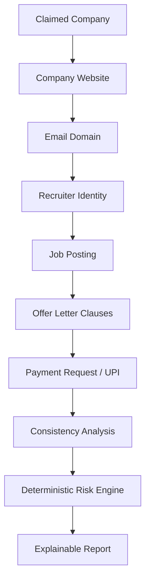

# OfferGuard
### Verify Before You Apply.

**OfferGuard** is an AI-powered employment offer verification and recruitment-fraud intelligence platform designed to protect college students, final-year undergraduates, and entry-level job seekers from predatory internship scams, fee extortion, and recruiter impersonation.

OfferGuard is **NOT** a simple binary "fake job classifier". Instead, it operates as an **AI-assisted investigation workbench**:
```
SUBMIT OFFER → EXTRACT INFORMATION → INVESTIGATE → CROSS-CHECK EVIDENCE → ASSESS RISK → EXPLAIN FINDINGS → RECOMMEND ACTION → ESCALATE UNCERTAIN CASES → STORE CASE KNOWLEDGE
```

---

## 1. Core Architecture & Evidence Chain

OfferGuard's signature differentiator is the **Visual Evidence Chain (Evidence Graph)**, demonstrating forensic traceability behind every assessment:



### Deterministic Risk Scoring
**Rule**: The LLM never decides the final score directly. Gemini 3.8 Flash extracts structured entities, interprets semantic nuances, and generates plain-language explanations. The risk calculation is governed by a **deterministic, configurable scoring weights engine**:

| Signal Vector | Default Weight | Description |
|---|---|---|
| **Registration / Onboarding Fee** | `+20 pts` | Direct violation of AICTE Rule 4.1 |
| **Personal UPI Handle** | `+20 pts` | Direct payment to personal virtual address (VPA) |
| **Recruiter Domain Mismatch** | `+15 pts` | Corporate recruiter using generic Gmail/Yahoo |
| **Company Inconsistency** | `+15 pts` | Conflicting incorporation or ROC data |
| **Coercive Urgency Language** | `+10 pts` | "Within 30 mins to avoid cancellation" |
| **Sensitive Document Harvest** | `+10 pts` | Aadhaar/PAN cards solicited over insecure chats |
| **Unrealistic Compensation** | `+8 pts` | High stipend without technical assessment |
| **Suspicious Lookalike Domain** | `+15 pts` | Typosquatted TLDs (.xyz mimicking corporate portals) |

#### Risk Levels:
- **0 – 19**: `LOW` (Verified / safe)
- **20 – 39**: `MEDIUM` (Ambiguous signals, advisory warning)
- **40 – 69**: `HIGH` (Multiple critical red flags identified)
- **70 – 100**: `CRITICAL` (Confirmed extortion or blacklisted identifier)

---

## 2. Six Fictional Demo Cases

OfferGuard ships with 6 comprehensive fictional demo scenarios pre-configured for live hackathon evaluation:
1. **Case 1 (OG-2026-0001)**: Legitimate Internship (*Infosys Springboard* — verified enterprise domain, zero fees).
2. **Case 2 (OG-2026-0002)**: Registration Fee Scam (*ApexCyber* — ₹2,500 police clearance fee via UPI with 30-min timer).
3. **Case 3 (OG-2026-0003)**: Fake Training Fee Scheme (*CloudTech* — ₹4,800 mandatory training course before joining).
4. **Case 4 (OG-2026-0004)**: Recruiter / Domain Mismatch (*Microsoft Impersonation* — recruiter using personal Gmail).
5. **Case 5 (OG-2026-0005)**: MacBook Courier Bond (*QuantumCloud* — ₹1,500 deposit for laptop delivery).
6. **Case 6 (OG-2026-0006)**: Human Review Required (*Vyom Robotics* — early startup with restrictive non-compete clause).

---

## 3. Technology Stack

- **Frontend**: React 19, TypeScript, Vite, Tailwind CSS, Lucide Icons, Recharts (Responsive charts).
- **Backend**: Node.js / Express with TypeScript, REST APIs.
- **AI Engine**: Google Gemini API (`gemini-3.8-flash`) with structured schema generation.
- **Evidence System**: Graph nodes with confidence scores, impact weights, and source metadata.
- **Security & Privacy**: Immutable audit trails, data minimization, and out-of-band verification warnings.

---

## 4. API Endpoints

- `POST /api/analyze/text`: Submit offer text, PDF OCR output, or screenshot notes for investigation.
- `GET /api/cases`: Fetch all cases with filtering by risk level and review status.
- `GET /api/cases/:id`: Detailed case view including raw text, extracted entities, and audit trail.
- `POST /api/reviews`: Record human reviewer determinations (`VERIFIED`, `WARNING`, `SCAM`, `NEEDS MORE INFORMATION`).
- `GET /api/intelligence`: Query central scam patterns and suspicious entities registry.
- `POST /api/intelligence/entity`: Add newly blacklisted identifier (UPI, domain, email, company).
- `GET /api/analytics`: Aggregated institutional statistics and Recharts telemetry.
- `GET / PUT /api/settings/scoring`: View or dynamically tune risk scoring weights.

---

## 5. Hackathon Demonstration Flow (2–3 Minutes)

1. Open **OfferGuard** and navigate to **Verify Opportunity**.
2. Click **Case 2: Registration Fee Scam** under the 1-Click Demo Scenarios.
3. Observe instant entity extraction, red flags, and the visual **Evidence Chain**.
4. Review the plain-language explanation and recommended action ("DO NOT PAY").
5. Click **Request Placement Review** to escalate to faculty.
6. Switch to the **Reviewer Portal** tab, select Case 2, inspect the evidence, and issue a signed verdict (`SCAM`).
7. Watch the blacklisted UPI identifier (`apexcyber@okaxis`) automatically feed into the **Scam Intelligence Registry**.
8. View the **Analytics** tab to see real-time student funds protected in INR.
